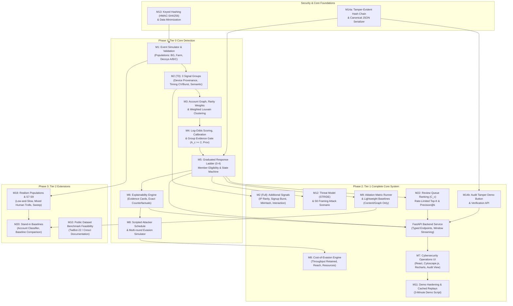

# BreachX 2026 / HYDRA: Comprehensive Implementation Plan
**Specification Version:** v1.7  
**Precedence Order:** Section 21 > Section 20 > All Other Sections  
**Status:** In Progress — Autonomous Execution  

---

## 1. Architectural Dependency Graph

---

## 2. Phased Build Order and Acceptance Milestones

### Phase 1 — Tier 0: The Functional Detection Core
*Target: ~40% of implementation scope, authoritative rules from 21.13 and 21.14.*

1. **Security-First Core (`backend/app/core/security.py`, `backend/app/audit/hasher.py`)**
   - HMAC-SHA256 for all IP prefixes and device identifiers.
   - Secret key loaded from environment (`HYDRA_HMAC_SECRET`).
   - Canonical JSON serializer (`canonical_json`) with deterministic key ordering and compact formatting.
   - Hash chain implementation: $h_i = \text{SHA256}(h_{i-1} \parallel \text{canonical\_json}(record_i))$.
   - Audit integrity verifier returning OK or exact corrupted index.

2. **Deterministic Event Simulator (`backend/app/simulator/`)**
   - Configurable master seed (`seed=42` for tuning, `seed=1337` for held-out evaluation).
   - Population generator matching §4.1:
     - Background users: diurnal posting, normal content, sparse interactions, home/campus shared IPs.
     - Bot farm: shared device fingerprints, burst posting, semantic duplication.
     - Decoy A (Fan Community): organic creation, diverse devices, high semantic/hashtag similarity.
     - Decoy B (News Account): single account, high posting rate, rigid interval regularity.
     - Decoy C (Campus NAT): multiple independent accounts sharing single IP range, diverse devices/behavior.
   - Hidden ground truth labels separated completely from detector pipeline.
   - Pre-registered population overlap generator (§20.3) with intended vs. measured reporting.

3. **Tier 0 Signal Extraction (`backend/app/signals/`)**
   - Provenance: Shared device links (pairwise graph edges).
   - Behavioral Timing:
     - Posting interval regularity: Coefficient of Variation ($CV = \sigma / \mu$) and entropy.
     - Synchronized posting: windowed burst alignment vs. shuffled-time null distribution.
   - Content:
     - Semantic similarity: Cosine similarity of sentence embeddings (with deterministic offline hashing/bag-of-words fallback when PyTorch/model unavailable).

4. **Account Graph & Louvain Clustering (`backend/app/graph/`)**
   - Accounts as nodes.
   - Edge types with normalized weights: device sharing, content similarity, co-timing.
   - Inverse-popularity rarity weighting ($w = 1.0 / \log_2(2 + n)$) preventing giant false clusters on shared IPs.
   - Weighted Louvain community detection via NetworkX with fixed seed and configurable resolution.
   - Cluster size ($\ge 3$) and internal edge density filters.

5. **Scoring, Evidence Gate, and Response Ladder (`backend/app/scoring/`, `backend/app/policy/`)**
   - Null-distribution percentile normalization $x_s(c) \in [0, 1]$.
   - Piecewise linear/logistic calibration: $f_s(x) = \max(0, (x - x0_s)/(1 - x0_s))$ with $x0_s = 0.9$.
   - Group-level evidence capping ($E_g \le E_{\max} = 5.0$).
   - Authoritative Non-Compensatory Gate (§21.1):
     - Active groups $A_c \ge 2$, where one **must** be Provenance for states 1–3.
     - Behavior-only clusters stay at State 0 (Observe).
   - Temporal exponential moving-average decay: $R_c(t) = \lambda R_c(t-1) + (1-\lambda) L_c(t)$.
   - Per-account state default (§21.14): state held per account, cluster state = median of eligible members.
   - Member-level eligibility (§21.12, 21.14): an account must have its own provenance link to another cluster member to be eligible for states 1–3. Ineligible members remain at Observe with a review flag.
   - Graduated Ladder: 0 (Observe), 1 (Throttle), 2 (Challenge), 3 (Temporary Restriction TTL), 4 (Human Escalation).
   - Strict invariants: no state skipping, hysteresis exit thresholds ($T - 0.5$).

6. **Explainability & Counterfactual Engine (`backend/app/explainability/`)**
   - Additive log-odds attribution per signal and group.
   - Evidence cards for Decoy (showing why gate refused) and Bot Farm (showing multi-group activation).
   - Counterfactual recalculation: exact state without each signal group.

7. **Tier 0 Invariant Testing & Exit Checks**
   - Decoy A and Decoy B stay at Observe in S1 (zero user-impacting actions).
   - S2 Bot Farm progresses from Observe -> Throttle -> Challenge.
   - Eligible-member test: 40-account farm (15 with device link, 25 without) -> 15 eligible, 25 Observe.
   - Mixed-cluster test: bot + legitimate accounts linked by content -> legitimate accounts stay at Observe.
   - Same seed reproduces exact bit-for-bit event stream and audit chain.

---

### Phase 2 — Tier 1: Complete Core System (Must Ship)

1. **Full Signal Suite (`backend/app/signals/`)**
   - Shared IP range with rarity weighting.
   - Account creation burst (Poisson surprise score against null).
   - Lexical near-duplicate detection via MinHash/Jaccard shingles.
   - Interaction timing and reciprocal amplification.
   - Posting rate as context modifier (shown in UI, excluded from gate).

2. **Scenario S6 & STRIDE Threat Model (`backend/app/scenarios/`, `docs/THREAT_MODEL.md`)**
   - Adversary attempts framing attack by copying fan community keywords.
   - Provenance gate and member-level eligibility reject automated restriction on the framed legitimate group.

3. **Rate-Limited Review Queue & Ranking (`backend/app/policy/review_queue.py`)**
   - Coordination score $C_c = E_{\text{Behavioral}} + E_{\text{Content}}$ (no provenance required).
   - Priority queue capped at top $K=5$ entries per window.
   - Precision@k tracking.

4. **Scripted Attacker & Cost-of-Evasion Engine (`backend/app/simulator/attacker.py`)**
   - Multi-round schedule:
     - Round 1: Naive high-frequency coordinated posting.
     - Round 2: Content paraphrasing (defeats exact MinHash, tests semantic).
     - Round 3: Timing jitter (widens interval dispersion, reduces burstiness).
     - Round 4: Infrastructure rotation (fewer accounts per device/IP).
   - Metrics: Primary = Throughput retained (posts/account-hour vs unevaded), Secondary = reach retained, distinct IPs/devices needed.

5. **Evaluation Suite & Ablation Matrix (`backend/app/evaluation/`)**
   - Runs S1, S2, S3, S4, S5, S6.
   - Systematic ablation matrix disabling one signal family at a time.
   - Lightweight baselines: Content-only and Graph-only detectors without gate.
   - Tuning seeds vs. held-out seeds report generation.
   - Formal Claim Audit (§19.6, 19.7).

6. **FastAPI Backend Service (`backend/app/main.py`, `backend/app/api/`)**
   - Endpoints:
     - `GET /api/health`
     - `GET /api/scenarios`
     - `POST /api/simulation/run`
     - `POST /api/simulation/step`
     - `POST /api/simulation/reset`
     - `GET /api/simulation/graph`
     - `GET /api/simulation/clusters/{cluster_id}`
     - `GET /api/simulation/evidence/{cluster_id}`
     - `GET /api/audit/logs`
     - `POST /api/audit/verify`
     - `POST /api/audit/tamper` (for interactive integrity demo)
     - `GET /api/review-queue`
     - `GET /api/evaluation/ablation`
     - `GET /api/evaluation/metrics`

7. **Interactive Frontend Dashboard (`frontend/`)**
   - Modern cybersecurity SOC aesthetic (dark mode, crisp typography, clean status badges).
   - Primary Views:
     - **Cluster Graph View:** Force-directed / cytoscape network, nodes colored by cluster, halo colored by policy state, click-to-inspect.
     - **Evidence & Explainability Panel:** Signal contribution stacked bars, active groups checklist, gate status, exact counterfactuals, representative samples.
     - **Decoy Inspection Focus:** Direct one-click comparison showing fan community / news account gate refusal.
     - **Response Ladder & Audit Timeline:** State transitions linked to cryptographically chained audit events, interactive "Verify Hash Chain" and "Simulate Tamper" buttons.
     - **Arms-Race & Cost-of-Evasion View:** Attacker round-by-round adaptation vs. throughput hit.
     - **Scenario Runner Controls:** Scenario selector (S1–S6), seed input, Play/Pause/Step/Reset controls, ground-truth toggle.

8. **Demo Hardening & 3-Minute Script (`docs/DEMO_SCRIPT.md`)**
   - Pre-computed cache for instant replay.
   - Deterministic 3-minute flow matching Section 21.16:
     - 0:00–0:15: Quiet network (S1) -> zero actions, synthetic label.
     - 0:15–0:45: Bot campaign launches (S2) -> clusters form, evidence builds.
     - 0:45–1:30: Decoy tested -> fan group trips content, gate refuses action, counterfactual shown.
     - 1:30–2:00: Bot farm escalates -> Observe -> Throttle -> Challenge -> audit entries.
     - 2:00–2:45: Attacker adapts (S3/S4) -> cost-of-evasion meter, escape rate & queue load.
     - 2:45–3:00: Audit log verification & tamper demo, ablation matrix, honest limits.

---

### Phase 3 — Tier 2: Realism, Harder Populations & Baselines

1. **Harder Populations & Scenarios S7–S9 (`backend/app/simulator/harder_populations.py`)**
   - Low-and-slow bots, partially automated accounts, human troll accounts.
   - Scenario S7 (Low-and-Slow), S8 (Mixed-Actor Campaign), S9 (Parameter Sweep).
2. **Stand-in Baseline Classifiers (`backend/app/evaluation/baselines.py`)**
   - Per-account classifier (RandomForest / LogisticRegression on account features).
   - Baseline comparison table demonstrating failure modes of isolated classifiers.
3. **Public Dataset Documentation (`docs/PUBLIC_DATASET_ANALYSIS.md`)**
   - Assessment of Cresci / TwiBot-22 benchmark compatibility and limitations.

---

## 3. Milestones and Acceptance Checklist

- [ ] **M1:** Simulator + Ground Truth + Validation Report ($20.3$)
- [ ] **M13:** Keyed-hash Identifiers (HMAC-SHA256)
- [ ] **M2:** Signal Families (Isolation Unit Tests)
- [ ] **M3:** Account Graph + Rarity Weights + NetworkX Louvain
- [ ] **M4:** Scoring + Calibration + Evidence-Group Gate
- [ ] **M5:** Policy State Machine + Invariants ($I_1$ to $I_6$)
- [ ] **M6:** Explainability Engine + Counterfactuals
- [ ] **M14a:** Tamper-evident Audit Log + Hash Chain Verifier
- [ ] **M14b:** Tamper Demo Feature + Corrupted Index Detection
- [ ] **M22:** Review Queue Coordination Score & Ranking ($C_c$)
- [ ] **M8:** Scripted Attacker Schedule + Cost-of-Evasion Analysis
- [ ] **M12:** Threat Model Document + S6 Framing Attack Scenario
- [ ] **M9:** Ablation Matrix & Lightweight Baselines
- [ ] **M7:** Interactive React Cybersecurity Dashboard
- [ ] **M11:** Demo Hardening & 3-Minute Script Execution
- [ ] **M20:** Baselines (Per-Account Classifier, Content-Only, Graph-Only)
- [ ] **M18:** Harder Populations (S7, S8, S9)
- [ ] **M21:** Claim Audit against Section 19.6 / 19.7
